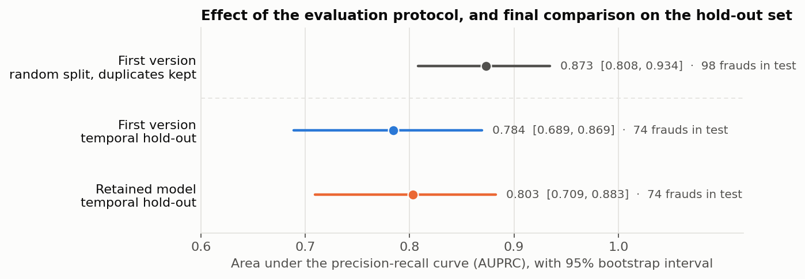
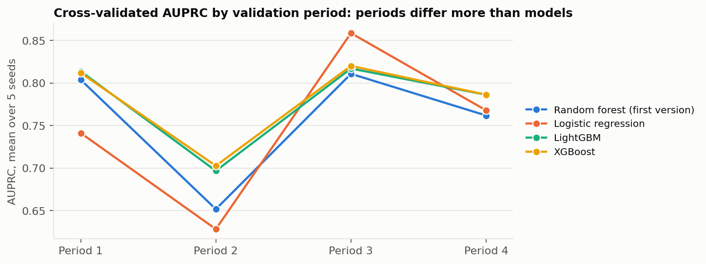
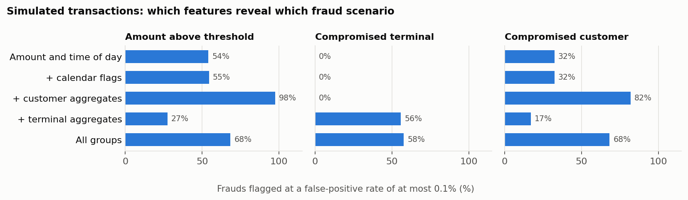
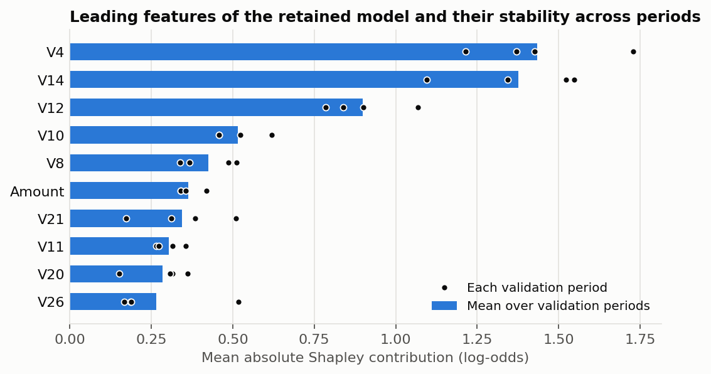
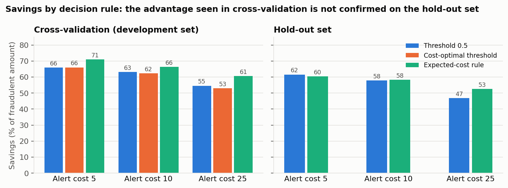

# Credit Card Fraud Detection

Supervised detection of fraudulent card transactions on a highly imbalanced dataset
(0.17% of frauds), evaluated under a protocol that respects the chronology of the
transactions, with the aim of a deployable prototype: a trained and calibrated model,
a validated REST API and an interactive dashboard.

> **Status — version 2.** The seven steps of the roadmap are complete, including the
> single evaluation on the hold-out set ([result 8](#8-final-evaluation-on-the-hold-out-set)).
> A summary is given in the [technical report](docs/REPORT.md) and the model is
> described in its [model card](docs/MODEL_CARD.md). The first version is preserved
> under the tag `v0-legacy`.



## Contents

1. [Results](#results)
2. [Method](#method)
3. [Prediction service](#prediction-service)
4. [Reproducing the results](#reproducing-the-results)
5. [Repository layout](#repository-layout)
6. [Roadmap](#roadmap)
7. [Limitations](#limitations)
8. [History](#history)
9. [References](#references)

## Results

All tables below are generated from the files in `results/` by
`scripts/update_readme.py`. The reasoning behind each choice is recorded in
[`docs/DECISIONS.md`](docs/DECISIONS.md) and the day-to-day observations in
[`docs/JOURNAL.md`](docs/JOURNAL.md).

### 1. The evaluation protocol of the first version was optimistic

The same model (random forest, 100 trees, default settings) is evaluated under the
protocol of the first version and under a protocol that removes duplicated rows and
tests on transactions strictly later than the training period.

<!-- BEGIN:protocol -->
| Evaluation protocol | Frauds in test | Precision | Recall | F1 | AUPRC [95% CI] |
|---|---|---|---|---|---|
| Random stratified split, duplicates kept (first version) | 98 | 0.941 | 0.816 | 0.874 | 0.873 [0.808, 0.934] |
| Temporal hold-out, duplicates removed | 74 | 0.962 | 0.689 | 0.803 | 0.784 [0.689, 0.869] |
<!-- END:protocol -->

Precision, recall and F1 are computed at a threshold of 0.5. Under the first protocol,
344 test rows, 8 of them frauds, were exact copies of training rows, and the random
split let the model train on transactions later than those it was tested on. The two
test sets differ and their confidence intervals overlap: the comparison shows the
direction of the bias rather than its exact size.

### 2. Gradient-boosted trees improve on the random forest by a small, consistent margin

Expanding-window cross-validation over four consecutive periods of the development set,
five seeds, no imbalance treatment. The hold-out set is not used.

<!-- BEGIN:models -->
| Model | AUPRC, mean over seeds (std) | AUPRC per validation period | Recall at FPR ≤ 0.1% |
|---|---|---|---|
| Random forest (first version) | 0.757 (0.007) | 0.804, 0.652, 0.811, 0.762 | 0.803 |
| Logistic regression | 0.749 (0.000) | 0.741, 0.628, 0.859, 0.768 | 0.792 |
| LightGBM | 0.778 (0.003) | 0.814, 0.697, 0.817, 0.786 | 0.803 |
| XGBoost | 0.780 (0.002) | 0.812, 0.703, 0.820, 0.786 | 0.795 |
<!-- END:models -->



Both boosted models exceed the random forest on each of the four periods and for each of
the five seeds. The two boosted models cannot be told apart on AUPRC, and no model
improves the recall at a low false-positive rate. Performance differs far more between
periods than between models, which bounds what this dataset can resolve.

XGBoost is retained. With equal accuracy, it proved the more robust of the two to its
settings during the search (see decision D2).

### 3. Correcting the class imbalance does not help

<!-- BEGIN:imbalance -->
| Imbalance treatment | AUPRC, mean over seeds (std) |
|---|---|
| None | 0.780 (0.002) |
| Class weighting | 0.775 (0.001) |
| Random under-sampling | 0.747 (0.008) |
| SMOTE | 0.780 (0.002) |
<!-- END:imbalance -->

Treatments are applied to the training folds only. None of them improves on the
untreated model; under-sampling discards information and lowers performance. The model
is therefore trained on the original class proportions.

### 4. Sigmoid calibration improves the predicted probabilities

<!-- BEGIN:calibration -->
| Calibration | Brier score | Log loss | AUPRC |
|---|---|---|---|
| None | 0.000522 | 0.00314 | 0.772 |
| Sigmoid (Platt) | 0.000483 | 0.00312 | 0.772 |
| Isotonic | 0.000554 | 0.00637 | 0.726 |
<!-- END:calibration -->

The classifier is fitted on the first part of each training window and the calibrator on
the last part. Sigmoid calibration lowers the Brier score without altering the ranking
of the transactions. Isotonic calibration, fitted on a few tens of frauds, introduces
ties that degrade the ranking.

### 5. Behavioural features are decisive when card and terminal histories are available

The main dataset carries no identifier, so features describing the habits of a customer
or the recent history of a terminal cannot be built on it. They are studied on simulated
transactions that follow the specification of the *Fraud Detection Handbook* simulator
(about 1.8 million transactions over six months, three fraud scenarios). The retained
model is cross-validated with each group of features; each training window ends seven
days before its validation period, the delay after which labels are assumed known.

<!-- BEGIN:behavioural -->
| Feature set | Features | AUPRC, mean over seeds (std) | Recall at FPR ≤ 0.1% | Recall, amount above threshold | Recall, compromised terminal | Recall, compromised customer |
|---|---|---|---|---|---|---|
| Amount and time of day | 3 | 0.164 (0.000) | 0.139 | 0.541 | 0.001 | 0.324 |
| + calendar flags | 5 | 0.163 (0.000) | 0.139 | 0.545 | 0.001 | 0.324 |
| + customer aggregates | 12 | 0.349 (0.000) | 0.323 | 0.976 | 0.002 | 0.819 |
| + terminal aggregates | 9 | 0.590 (0.001) | 0.419 | 0.275 | 0.559 | 0.171 |
| All groups | 20 | 0.717 (0.003) | 0.618 | 0.684 | 0.578 | 0.682 |
<!-- END:behavioural -->



The last three columns give, for each fraud scenario, the share of frauds flagged at
the same false-positive rate. Frauds on compromised terminals are invisible without the
terminal history and more than half are caught with it; customer aggregates raise the
detection of frauds on compromised customers. Calendar flags bring nothing. With all
groups together, AUPRC is highest, but the detection of the first and third scenarios
at this false-positive rate is lower than with customer aggregates alone.

These figures must be read with three reservations. The data are synthetic and the
fraud scenarios were designed so that such features are informative: the experiment
validates the feature pipeline and its point-in-time correctness, not a discovery about
real fraud. The hyper-parameters are those selected on the main dataset and were not
tuned again, which penalises the smallest feature sets. And the terminal risk is known
with a seven-day delay, which bounds the detection of a terminal compromised for 28 days.

### 6. Weighing each alert by the amount at stake lowers the cost of fraud

A probability must be turned into a decision. The decision rules below are compared
under an explicit cost model: every alert costs a fixed handling cost, and a fraud that
raises no alert costs the amount of the transaction. Savings are the share of the
fraudulent amounts that is avoided, net of the cost of the alerts. The probabilities are
those of the retained, calibrated model on the validation periods of the main dataset.

<!-- BEGIN:costs -->
| Decision rule | Savings, alert cost 5 | Savings, alert cost 10 | Savings, alert cost 25 | Alerts per 100,000 (alert cost 10) | Precision | Recall |
|---|---|---|---|---|---|---|
| Probability threshold of 0.5 (first version) | 66.0% | 63.1% | 54.6% | 116 | 0.874 | 0.716 |
| Cost-optimal probability threshold | 66.0% | 62.3% | 53.0% | 140 | 0.749 | 0.739 |
| Expected-cost rule (probability x amount > alert cost) | 71.0% | 66.3% | 60.6% | 134 | 0.435 | 0.412 |
| Oracle (upper bound) | 97.6% | 95.7% | 90.4% | | | |
<!-- END:costs -->

The expected-cost rule alerts when the probability of fraud multiplied by the amount
exceeds the cost of an alert. It follows from the cost model, has no fitted parameter
and gives the highest savings for the three alert costs considered, in every validation
period for alert costs of 10 and 25 and in three periods out of four for an alert cost
of 5. It does so by concentrating alerts on large amounts: it flags fewer frauds than a
threshold of 0.5 but the more expensive ones. A single probability threshold tuned for
cost does not improve on 0.5; its value varies widely from one period to another. The
expected-cost rule, with an alert cost of 10 that can be changed in the configuration,
is the rule retained for the prediction service (decision D3).

Three reservations apply. The alert costs are assumptions, not measured costs of a
card issuer. Half of the frauds of the validation periods are worth less than 19, and
the rule deliberately ignores most of them, whereas a small fraud may in practice
precede larger ones on the same card. And the gap to the oracle remains large: the
remaining cost comes from frauds to which the model assigns a low probability.

### 7. Each prediction can be decomposed exactly into feature contributions

Each prediction of the retained model is attributed to its input features by Shapley
values, computed exactly for tree ensembles. For every transaction, the contributions
and a base value add up to the log-odds predicted by the model (largest deviation
observed: of the order of 10⁻⁵). The table gives the ten features with the largest mean
absolute contribution over the validation periods.

<!-- BEGIN:attributions -->
| Rank | Feature | Mean absolute contribution (log-odds) | Rank in each period |
|---|---|---|---|
| 1 | `V4` | 1.435 | 1, 2, 2, 1 |
| 2 | `V14` | 1.377 | 2, 1, 1, 2 |
| 3 | `V12` | 0.898 | 3, 3, 3, 3 |
| 4 | `V10` | 0.515 | 4, 4, 5, 4 |
| 5 | `V8` | 0.426 | 8, 8, 4, 5 |
| 6 | `Amount` | 0.364 | 7, 5, 7, 6 |
| 7 | `V21` | 0.345 | 6, 6, 8, 20 |
| 8 | `V11` | 0.303 | 10, 10, 11, 7 |
| 9 | `V20` | 0.284 | 9, 9, 9, 23 |
| 10 | `V26` | 0.265 | 5, 16, 17, 16 |
<!-- END:attributions -->



The four leading features keep their rank to within one position in every period, and
the ranking is nearly identical from one seed to another. Beyond them the ranking is
only moderately stable between periods: an explanation that rests on the lower-ranked
features should be read with caution.

Two reservations apply. Apart from the amount and the time of day, the features are
anonymised principal components, so an explanation names a component and not a
property of the transaction that an analyst could act on. And a contribution describes
how the model uses a feature; it is not evidence of what causes fraud.

### 8. Final evaluation on the hold-out set

The stored model was evaluated once on the last 20% of the transactions, which no
modelling choice had used. It is compared, on the same transactions, with the model and
the decision rule of the first version (random forest with default settings, threshold
of 0.5), trained on the same development period. The random forest is fitted on the
whole development period, whereas the classifier of the retained model is fitted on its
first 80%, the rest being reserved for calibration. Intervals are 95% percentile
bootstrap intervals obtained by resampling transactions; those of the differences are
paired. Resampling treats transactions as independent, which ignores their dependence
in time and may make the intervals somewhat too narrow.

<!-- BEGIN:final -->
| System | AUPRC | Recall at FPR ≤ 0.1% | Savings, alert cost 10 | Alerts | Frauds flagged |
|---|---|---|---|---|---|
| First version: random forest, threshold 0.5 | 0.784 [0.689, 0.869] | 0.797 [0.689, 0.883] | 42.4% [13.3%, 71.2%] | 53 | 68.9% |
| Retained model, threshold 0.5 | 0.803 [0.709, 0.883] | 0.797 [0.696, 0.887] | 57.8% [29.2%, 83.7%] | 57 | 73.0% |
| Retained model, expected-cost rule | 0.803 [0.709, 0.883] | 0.797 [0.696, 0.887] | 58.2% [28.8%, 82.5%] | 77 | 29.7% |
| Difference, last row minus first | +0.019 [-0.004, +0.046] | +0.000 [-0.038, +0.044] | +15.9% [-3.8%, +41.7%] | | |
| Share of bootstrap resamples in which the last row is better | 94% | 38% | 90% | | |
<!-- END:final -->

Differences in savings are in percentage points. Savings for the three alert costs
considered:

<!-- BEGIN:final_sensitivity -->
| System | Savings, alert cost 5 | Savings, alert cost 10 | Savings, alert cost 25 |
|---|---|---|---|
| First version: random forest, threshold 0.5 | 45.8% | 42.4% | 32.1% |
| Retained model, threshold 0.5 | 61.5% | 57.8% | 46.8% |
| Retained model, expected-cost rule | 60.5% | 58.2% | 52.5% |
| Oracle (upper bound) | 97.1% | 95.0% | 89.7% |
<!-- END:final_sensitivity -->



The cost-optimal threshold was not carried to the hold-out set. What these figures
support, and what they do not:

- **Ranking.** The retained model has the higher AUPRC, by a margin close to the one
  measured in cross-validation, and it is ahead in most bootstrap resamples. The
  interval of the difference nevertheless includes zero: with 74 frauds, the
  improvement is likely but not established at the 95% level. The recall at a low
  false-positive rate is unchanged.
- **Cost.** Savings are markedly higher than those of the first version for the three
  alert costs, but the interval of the difference is wide and includes zero: the
  fraudulent amount of the hold-out set is concentrated in a few transactions.
- **Decision rule.** On the hold-out set, the gain in savings comes from the model, not
  from the rule: with a threshold of 0.5 the retained model saves about as much as with
  the expected-cost rule for alert costs of 5 and 10, and less only for 25. The
  advantage of the expected-cost rule observed in cross-validation (result 6) is
  therefore not confirmed. The rule is kept as decided before this evaluation, since
  changing it now would amount to tuning on the hold-out set.
- **Calibration.** The Brier score and the logarithmic loss of the stored model on the
  hold-out set are given in `results/final/holdout_evaluation.json`.

On the simulated transactions, the hold-out period confirms the cross-validated effect
of behavioural features (result 5):

<!-- BEGIN:final_simulated -->
| Feature set | Features | AUPRC, mean over seeds (std) | Recall at low FPR |
|---|---|---|---|
| Amount and time of day | 3 | 0.166 (0.001) | 0.150 |
| All behavioural groups | 20 | 0.773 (0.001) | 0.724 |
<!-- END:final_simulated -->

## Method

**Data.** [Credit Card Fraud Detection](https://www.kaggle.com/datasets/mlg-ulb/creditcardfraud)
dataset (Worldline and the Machine Learning Group of ULB): 284,807 transactions made
over two days in September 2013, 492 of them frauds. The features are 28 principal
components (`V1`–`V28`), the amount and the time elapsed since the first transaction.
The file is not distributed with this repository; its checksum is verified before use.

**Simulated data.** A second table is generated by `fraud_detection.simulation`, an
independent implementation of the generative process specified in the *Fraud Detection
Handbook*: 5,000 customers and 10,000 terminals over 183 days, with three fraud
scenarios (amount above a threshold, compromised terminal, compromised customer). It is
used only for the study of behavioural features.

**Preparation.** Rows that are exact copies of an earlier row are removed (1,081 rows,
19 frauds). The elapsed time, which has no defined value outside the collection period,
is replaced by a cyclic encoding of the time of day.

**Split.** The last 20% of the transactions in chronological order form the hold-out set
(74 frauds). The first 80% form the development set (399 frauds), on which every choice
is made by expanding-window cross-validation: each fold trains on the past and validates
on the period that follows.

**Metrics.** The primary metric is the area under the precision-recall curve (AUPRC),
which does not depend on a threshold and is suited to rare positives. The recall at a
false-positive rate of at most 0.1% is reported as a secondary metric. Confidence
intervals are obtained by bootstrap.

**Safeguards.** Unit tests check that no partition shares a row with another, that no
model is validated on transactions older than its training data, that re-sampling is
never applied to validation data, and that no behavioural feature depends on later
transactions or on labels younger than the label delay. They run in continuous integration on every push.

## Prediction service

The model in service is stored in `models/fraud_model/`: the classifier in the native
JSON format of XGBoost and a metadata file holding the calibration coefficients, the
decision rule and the provenance of the model. No pickled object is used. The model is
trained on the development set only, and was evaluated once on the hold-out set
(result 8).

**API.**

```bash
pip install -e ".[api]"
uvicorn api.main:app --port 8000
```

| Endpoint | Purpose |
|---|---|
| `GET /health` | Liveness of the service and availability of the model |
| `GET /version` | Provenance of the model: training data checksum, commit, calibration, decision rule |
| `POST /predict` | Probability of fraud, decision and, on request, explanation for one transaction |
| `GET /docs` | Interactive documentation |

A request gives the 30 fields of a transaction by name (`time_seconds`, `amount`, `V1`
to `V28`). Missing, unknown, negative-amount or non-finite values are rejected with a
422 status. Example, abridged, for a fraud of the development period:

```bash
curl -X POST "http://127.0.0.1:8000/predict?explain=true&top_k=2" \
     -H "Content-Type: application/json" -d @transaction.json
```

```json
{
  "fraud_probability": 0.9109,
  "decision": {
    "rule": "expected_cost",
    "alert_cost": 10.0,
    "expected_loss": 1648.49,
    "alert": true
  },
  "model_version": "0.2.0",
  "explanation": {
    "scale": "log-odds",
    "base_value": -5.886,
    "prediction": 2.325,
    "contributions": [
      {"feature": "V14", "value": -3.738, "contribution": 1.661},
      {"feature": "V12", "value": -6.998, "contribution": 1.573}
    ],
    "other_contributions": 4.977
  }
}
```

The contributions are expressed on the calibrated log-odds scale; with the base value,
they add up to the log-odds of the returned probability.

**Dashboard.**

```bash
pip install -e ".[dashboard]"
streamlit run dashboard/streamlit_app.py
```

The dashboard sends a transaction to the API and displays the probability, the decision
and the largest contributions. Four transactions of the development period, stored with
the model, can be loaded as examples; one of them is a fraud of small amount that the
decision rule deliberately does not flag.

**Container.**

```bash
docker build -t fraud-detection-api .
docker run -p 8000:8000 fraud-detection-api
```

The image contains the API and the model, without the experiment dependencies. It is
built and checked against the stored examples in continuous integration.

**Scope.** This is a prototype. The API is deliberately left open, without
authentication, so that it can be tried freely for testing and demonstration; it must
not be exposed as such to real transaction data. It also has no rate limiting, no
request logging and no monitoring of input drift, all of which a production service
requires.

## Reproducing the results

Python 3.11 is required.

```bash
git clone https://github.com/MarcelKossi/Fraud_detection_system.git
cd Fraud_detection_system
python -m venv .venv
source .venv/bin/activate        # Windows: .venv\Scripts\activate
pip install -e ".[dev]"
```

Download `creditcard.csv` from the dataset page and place it in `data/raw/`. Then:

```bash
pytest -q                               # unit tests and leakage guards
python scripts/prepare_data.py          # checksum, duplicates, partitions
python scripts/run_baseline.py          # result 1, about 10 minutes on 2 cores
python scripts/run_model_selection.py   # results 2 to 4, about 35 minutes on 2 cores
python scripts/run_behavioural_features.py   # result 5, about 25 minutes on 2 cores
python scripts/run_cost_analysis.py          # result 6, about 2 minutes on 2 cores
python scripts/run_explanations.py           # result 7, about 2 minutes on 2 cores
python scripts/train_final_model.py          # model in service, a few seconds
```

The final evaluation is deliberately protected against repetition:
`scripts/evaluate_holdout.py` refuses to run while `results/final/holdout_evaluation.json`
exists. To reproduce it, delete that file first.

```bash
python scripts/evaluate_holdout.py           # result 8, about 10 minutes on 2 cores
python scripts/update_readme.py         # regenerate the tables of the documents
python scripts/make_figures.py          # regenerate the figures
```

Every experiment reads `configs/config.yaml` and writes a JSON file to `results/`
containing its metrics together with the commit, the data checksum, the configuration
and the library versions.

## Repository layout

```
configs/config.yaml        data, split, evaluation and model settings
src/fraud_detection/       installable package
    data.py                loading, checksum, de-duplication
    features.py            feature sets
    splits.py              temporal hold-out, expanding-window folds, leakage checks
    metrics.py             AUPRC, recall at fixed FPR, bootstrap intervals
    models.py              model definitions
    sampling.py            imbalance treatments
    search.py              hyper-parameter search spaces
    calibration.py         probability calibration
    validation.py          cross-validated evaluation
    simulation.py          simulator of transactions with identifiers
    behavioural.py         customer and terminal aggregates
    costs.py               cost model and decision rules
    explain.py             attribution of predictions to features
    serving.py             deployable model: probability, decision, explanation
    experiment.py          provenance of results
scripts/                   experiment entry points
tests/                     unit tests
results/                   metrics (JSON) and generated summaries
docs/                      journal, decision log, model card, technical report
models/fraud_model/        model in service, its metadata and example transactions
api/                       REST API
dashboard/                 Streamlit dashboard
Dockerfile                 container image of the API
notebooks/                 exploratory analysis of the first version
```

## Roadmap

| Step | Content | State |
|---|---|---|
| 1 | Reference measurements, temporal protocol, tests | Done |
| 2 | Model selection, imbalance treatments, calibration | Done |
| 3 | Behavioural features on a dataset with card and terminal identifiers | Done |
| 4 | Cost-based decision rule | Done |
| 5 | Explanation of individual predictions | Done |
| 6 | Deployable prototype: serialised model, validated API, dashboard, container | Done |
| 7 | Final evaluation on the hold-out set, model card, technical report | Done |

## Limitations

- The dataset covers two days. Long-term changes in fraud patterns cannot be studied,
  and the hold-out set contains 74 frauds only: confidence intervals are wide.
- The features are anonymised principal components. They cannot be interpreted in
  business terms and do not allow aggregates per card or per merchant.
- Differences between models below about 0.01 of AUPRC cannot be resolved with the
  number of frauds available.
- The hyper-parameter search is limited to 30 random configurations per boosted model.
- Exact duplicate rows are removed as artefacts. They are about ten times richer in
  frauds than the rest of the file (19 of 1,081), so some may be genuine repeated
  attempts; keeping them with a split that never separates copies is an alternative
  that was not evaluated.
- Behavioural features are evaluated on synthetic data only; their benefit on real
  transactions is not measured here.

## History

The first version of this project trained a random forest with default settings and
reported precision, recall and F1 on a random split. Those figures are reproduced
exactly by `scripts/run_baseline.py`. Version 2 was started after finding that this
split places identical transactions on both sides and ignores chronology. The code of
the first version remains available under the tag `v0-legacy`.

## References

- A. Dal Pozzolo, O. Caelen, R. A. Johnson and G. Bontempi. *Calibrating Probability
  with Undersampling for Unbalanced Classification.* IEEE Symposium Series on
  Computational Intelligence, 2015. (Source of the dataset.)
- Y.-A. Le Borgne, W. Siblini, B. Lebichot and G. Bontempi. *Reproducible Machine
  Learning for Credit Card Fraud Detection – Practical Handbook.* Université Libre de
  Bruxelles, 2022. (Specification of the transaction simulator.)
- J. Davis and M. Goadrich. *The Relationship Between Precision-Recall and ROC Curves.*
  International Conference on Machine Learning, 2006.
- N. V. Chawla, K. W. Bowyer, L. O. Hall and W. P. Kegelmeyer. *SMOTE: Synthetic
  Minority Over-sampling Technique.* Journal of Artificial Intelligence Research, 2002.
- J. Platt. *Probabilistic Outputs for Support Vector Machines and Comparisons to
  Regularized Likelihood Methods.* Advances in Large Margin Classifiers, 1999.
- S. M. Lundberg and S.-I. Lee. *A Unified Approach to Interpreting Model Predictions.*
  Advances in Neural Information Processing Systems, 2017.
- S. M. Lundberg et al. *From Local Explanations to Global Understanding with
  Explainable AI for Trees.* Nature Machine Intelligence, 2020.
- T. Chen and C. Guestrin. *XGBoost: A Scalable Tree Boosting System.* ACM SIGKDD, 2016.
- G. Ke et al. *LightGBM: A Highly Efficient Gradient Boosting Decision Tree.* Advances
  in Neural Information Processing Systems, 2017.

## Author

TAMPLARE K. Marcel

## Purpose and terms of use

This project is a demonstration of technical expertise in machine learning, conducted
with the methodological standards of research. It is shared for demonstration and
research purposes.
